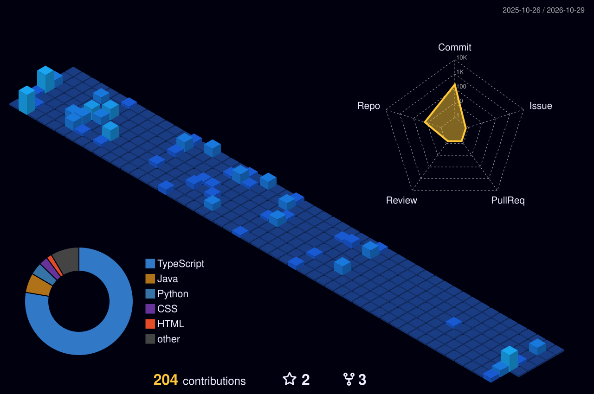

<p align="center">
  
</p>

<br>

## `~/sobre`

```js
const jailson = {
  nome: "Jailson Ferreira",
  funcao: "Fullstack Developer",
  stack: ["React", "Node.js", "Java", "Python", "MySQL", "Docker"],
  aprendendo: "sempre algo novo",
  motivacao: "transformar ideias em código",
  cafe: true,
};

jailson.build(); // criando coisas legais 💜
```

<br>

## `~/contatos`

<p align="center">
  <a href="https://www.instagram.com/lopes_wzx/" target="_blank"></a>
  <a href="https://jailson-ferreira.vercel.app/" target="_blank"></a>
  <a href="https://www.linkedin.com/in/jailson-ferreira-104352348/" target="_blank"></a>
</p>

<br>

## `~/stack`

<p align="center">
  
</p>

<br>

## `~/contribuicoes --3d`

<p align="center">
  
</p>

<br>

```bash
$ exit 0
# valeu por passar por aqui 💜
```
